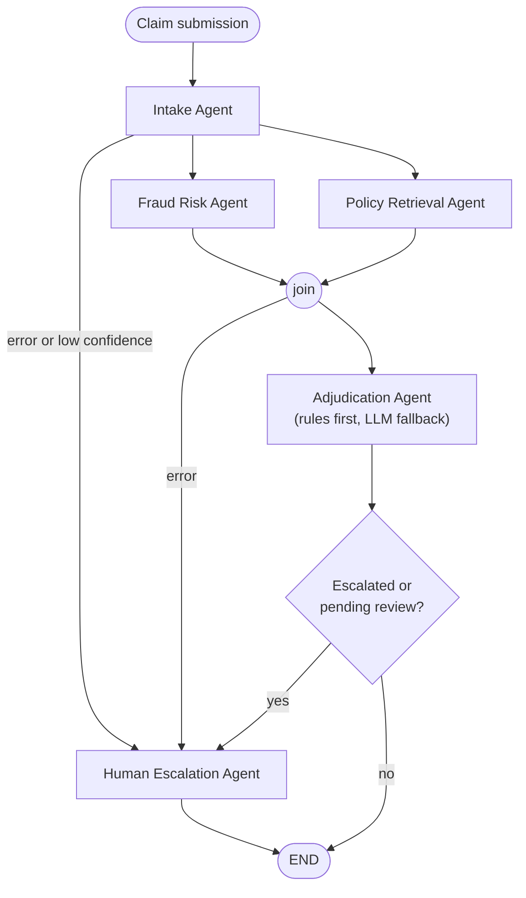

# Claims Triage

A multi-agent pipeline for triaging insurance claims: extracting structured
data from raw submissions, scoring fraud risk, checking policy coverage, and
routing each claim to an automated decision or a human reviewer.

## Architecture



- Fraud Risk and Policy Retrieval run in parallel; both only need the
  extracted claim.
- If Intake fails or its confidence is below the minimum, the claim goes
  straight to Human Escalation, since fraud and policy results on unreliable
  fields would be meaningless.
- High fraud risk never skips ahead or auto-denies. It is an input to
  Adjudication, which escalates the claim.
- A failure in any step produces an escalation packet with reason
  `processing_error` instead of dropping the claim.
- Each packet carries a `queue`: `fraud_review` when the reasons include
  high fraud risk, otherwise `adjudicator`.

- **Intake Agent** — parses a raw claim submission (form text, email body, PDF
  dump) into a structured `ExtractedClaim` using the LLM.
- **Fraud Risk Agent** — an XGBoost classifier (no LLM) that scores fraud risk
  from claim features and buckets it into `low` / `medium` / `high`.
- **Policy Retrieval Agent (RAG)** — hybrid Qdrant + BM25 search over policy
  clauses; coverage, deductible, and limits are parsed from the retrieved text
  with regex (no LLM).
- **Adjudication Agent** — applies deterministic rules first: auto-approve
  (low fraud, confident extraction and retrieval) or auto-escalate (high fraud,
  high-value claim, low confidence). Ambiguous cases fall back to the LLM.
- **Human Escalation Agent** — assembles an audit-ready packet for a human
  reviewer with the claim, policy result, fraud result, and decision.

A LangGraph `StateGraph` (`src/graph.py`) orchestrates the sequence above over
a shared `PipelineState`; each agent is an independent, individually testable
function.

All agents communicate through shared Pydantic schemas defined in
[`src/schemas.py`](src/schemas.py).

## Tech stack

- **Orchestration**: [LangGraph](https://github.com/langchain-ai/langgraph)
- **LLM and embeddings**: local [Ollama](https://ollama.com/) (`llama3.2:3b`,
  `all-minilm`), behind a provider abstraction in `src/llm.py`
- **Policy retrieval**: Qdrant (embedded/local mode), BM25 (`rank-bm25`)
- **Fraud risk**: scikit-learn, XGBoost, pandas, numpy
- **Schemas / config**: Pydantic, `python-dotenv`
- **Package management**: [uv](https://docs.astral.sh/uv/)

## Project structure

```
src/
  agents/      # intake, fraud_risk, policy_retrieval, adjudication, human_escalation
  config.py    # Decision thresholds, model/provider config, paths
  graph.py     # LangGraph pipeline
  llm.py       # LLM provider abstraction
  schemas.py   # Shared Pydantic data contracts
scripts/
  train_fraud_model.py   # Trains models/fraud_classifier.joblib
  build_policy_index.py  # Builds data/qdrant/ (Qdrant + BM25 + docstore)
  demo_scenarios.py      # Runs the pipeline over multiple scenarios
tests/
data/
  raw/claims.csv     # Sample claims dataset
  policy_docs/       # Policy documents indexed for retrieval
main.py
```

## Setup

Requires Python 3.14+, [uv](https://docs.astral.sh/uv/), and
[Ollama](https://ollama.com/).

```bash
uv sync
cp .env.example .env
ollama pull llama3.2:3b
ollama pull all-minilm
```

Build the two local artifacts the pipeline needs, from the project root:

```bash
uv run python -m scripts.train_fraud_model
uv run python -m scripts.build_policy_index
```

`ollama serve` must be running for Intake, Adjudication, and Policy Retrieval.

### Configuration

Runtime config lives in `src/config.py` and is overridable via environment
variables (see `.env.example`):

| Variable                                                                                     | Purpose                                      |
| -------------------------------------------------------------------------------------------- | -------------------------------------------- |
| `LLM_PROVIDER` / `LLM_MODEL` / `OLLAMA_BASE_URL`                                             | LLM used by the Intake and Adjudication agents |
| `EMBEDDING_MODEL`                                                                            | Embedding model for policy document retrieval |
| `DATA_DIR`, `POLICY_DOCS_DIR`, `QDRANT_PATH`, `QDRANT_COLLECTION_NAME`, `RAW_CLAIMS_DATASET` | Data paths                                   |
| `FRAUD_MODEL_PATH`                                                                           | Path to the trained fraud classifier         |

Decision boundaries (fraud auto-escalate threshold, auto-approve ceiling,
high-value claim cutoff, minimum extraction/retrieval confidence) are defined in
the `Thresholds` dataclass in `src/config.py`.

## Running

Both the API (`:8000`) and the Streamlit UI (`:8501`) with one command:

```bash
docker compose up --build
```

or without Docker:

```bash
uv sync --group frontend
./scripts/dev.sh
```

Open http://localhost:8501 for the UI and http://localhost:8000/docs for the
API. Use `API_PORT` / `UI_PORT` to change the published ports.

## Testing

```bash
uv run python -m pytest
```
